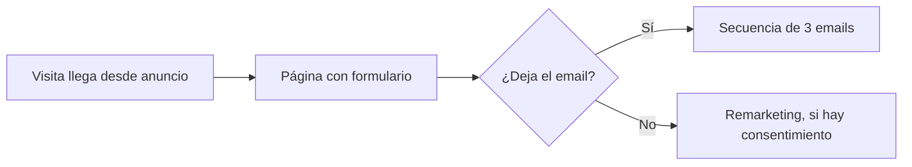

# Diagramas claros a partir de texto

## Cómo está escrito
- Lo que tú haces y recibes va en tú: cuentas, recibes, copias, pegas.
- Las preguntas van dirigidas a ti.
- Las instrucciones para la IA (Claude, Codex, Gemini o una IA local) van en imperativo: resume, elige, escribe, revisa.

## Qué hace
- Cuentas un proceso con palabras.
- Recibes el código de un diagrama (formato Mermaid) y tres pasos para verlo y bajarlo como imagen.
- No tienes que programar: copias, pegas y descargas.

## Qué diagramas puedes pedir
- Flujo (flowchart): procesos, embudos de venta, decisiones de sí o no, automatizaciones de n8n.
- Secuencia (sequenceDiagram): quién habla con quién y en qué orden. Por ejemplo cliente, web, pasarela de pago y correo.
- Calendario (gantt): campañas, lanzamientos e hitos con fechas.
- Estados (stateDiagram-v2): los estados por los que pasa un pedido, un contacto o una suscripción.
- Relaciones entre datos (erDiagram): qué tablas hay y cómo se conectan, por ejemplo clientes, pedidos y facturas.
- Recorrido del cliente (journey), mapa mental (mindmap) y línea de tiempo (timeline).

## Qué preguntar antes de empezar
1. ¿Qué proceso o idea quieres dibujar? Cuéntalo como se lo explicarías a alguien de palabra.
2. ¿Para quién es (cliente, equipo, tú) y dónde lo vas a poner (presentación, propuesta, Notion, web)?
3. ¿Qué tipo de diagrama quieres? Si no lo sabes, la IA elige uno y te explica por qué.
4. ¿Hay algún paso, fecha o nombre que sí o sí tenga que salir?
5. ¿Hay datos confidenciales? Si los hay, usa nombres genéricos como «Cliente A» o «Sistema de cobro».

## Paso a paso
1. Resume el proceso en tres a cinco líneas. Pide confirmación si ves huecos grandes.
2. Haz la lista de pasos y de decisiones (las que tienen respuesta sí o no).
3. Elige el tipo y la dirección: TD (de arriba abajo) para procesos largos, LR (de izquierda a derecha) para pocas etapas.
4. Escribe el código siguiendo estas reglas:
   - Pon como máximo unos 15 elementos por diagrama. Si hay más, haz dos: uno general y otro de detalle.
   - Usa identificadores cortos, sin espacios ni acentos (A, B, pago). El texto que se ve va entre comillas dobles.
   - Evita la palabra «end» en minúsculas dentro de una caja: rompe el diagrama. Escribe «Fin» o «End».
   - Evita identificadores que empiecen por «o» o «x» justo después de una flecha: Mermaid los lee como símbolos.
   - Para partir una línea dentro de una caja usa  .
   - Añade accTitle y accDescr para que el diagrama tenga título y descripción accesibles.
   - Usa pocos colores, y que se entienda igual sin ellos.
5. Revisa el código antes de entregarlo: identificadores repetidos, flechas a la nada, comillas o paréntesis sin cerrar.
6. Pide a la persona que compruebe que el diagrama se ve bien.

## Ejemplo mínimo

## Qué devolver
1. Un resumen de lo entendido, en una o dos frases, para que la persona lo confirme.
2. Un solo bloque de código con el diagrama, marcado como mermaid.
3. Cómo verlo, en tres pasos: abrir mermaid.live, pegar el código y descargar PNG o SVG. En GitHub se ve pegando el bloque en un archivo Markdown. En Notion, con un bloque de código de lenguaje Mermaid.
4. Una línea que invite a la persona a pegar el mensaje de error del editor, si sale, para corregirlo.
5. Un texto alternativo de una o dos frases que describa el diagrama para quien no lo pueda ver.
6. Una lista corta de los supuestos que se han hecho y de lo que queda por confirmar.

## Qué NO hacer
- No inventes pasos que no te hayan contado. Si falta uno, pregunta o márcalo en el diagrama como «Por confirmar».
- No metas datos personales reales (nombres de clientes, emails, DNI, claves) ni cifras internas confidenciales.
- El enlace de compartir de un editor online contiene el diagrama entero y lo ve cualquiera que lo tenga.
- No uses tipos de diagrama marcados como beta sin avisar: pueden fallar según la versión del editor.
- No digas que el diagrama está «validado». No puedes verlo dibujado. Di a la persona «comprueba que se ve bien».
- No hagas diagramas de 40 cajas. Si no cabe en una pantalla, se divide.
- No guardes archivos en la carpeta del usuario sin preguntar antes.

## Qué revisa una persona antes de usar el resultado
- Tú: que el diagrama refleja cómo trabajas de verdad. La IA solo dibuja lo que le cuentas.
- Quien responde del proceso, por ejemplo tu gestor o asesor: cualquier diagrama que describa consentimientos, protección de datos o facturación. Es un boceto, no un documento legal.
- Tú, antes de compartir el enlace de un editor online: que el diagrama no lleve datos personales ni cifras internas.
